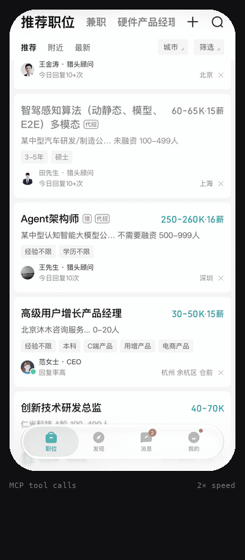

# phonectl-mcp

[中文](https://github.com/jiefeng-ai/phonectl-mcp/blob/main/README.zh-CN.md)

An MCP server that lets AI agents see and drive a real iPhone over a USB cable: screenshots, the text on screen, taps, swipes, typing, hardware buttons, apps and the clipboard. **macOS only.**

<p align="center"></p>
<p align="center"><sub>A script applying to one job in a recruiting app through phonectl-mcp: <code>read_text</code> finds the buttons, <code>tap</code> presses them. Personal details are pixelated; 2× speed.</sub></p>

Nothing is installed on the phone and nothing is jailbroken. It uses the developer services iOS already exposes to a trusted Mac (the same ones Xcode uses), and the touch and keyboard input path that iOS 27 opened over USB.

## Requirements

- A Mac. The USB tunnel and the on-screen text recognition (Apple Vision) are macOS-only.
- An iPhone on **iOS 27 or later**. Taps, swipes and typing need iOS 27. Screenshots and app control may also work on iOS 17–26, but this is untested.
- A USB data cable (a charge-only cable won't work).
- On the phone: **Developer Mode** turned on, and this Mac trusted. `phonectl doctor` walks you through both.
- [uv](https://docs.astral.sh/uv/).

Tested on an iPhone 17 Pro with iOS 27.2 and macOS 27.

## Install

```sh
uv tool install phonectl-mcp
phonectl install-service
phonectl doctor
```

- `install-service` runs the server at login as a launchd job. It listens on `http://127.0.0.1:47321/mcp` and creates an access token in `~/.config/phonectl/token`. It also prints the client setup below.
- `doctor` checks every link from the cable to the server and says what to do about anything that fails. `phonectl doctor --fix` mounts the developer disk image if it is missing.

### Connect a client

Claude Code:

```sh
claude mcp add --scope user --transport http phone http://127.0.0.1:47321/mcp \
  --header "Authorization: Bearer $(cat ~/.config/phonectl/token)"
```

Any other client that speaks streamable HTTP needs two things: the URL above, and the header `Authorization: Bearer <token>`.

### Why one server for every client

The phone keeps a single control connection to the Mac. If two programs each open their own, they keep knocking each other off. So one resident server owns the phone, and every agent and script connects to that server. Your own scripts can call the same tools with any MCP client library.

This only makes the connection safe to share. The server does not stop two agents from tapping the screen at the same time, so let one drive at a time.

## Tools

Coordinates are iOS points, which match the pixels of the screenshot the server returns (402×874 on an iPhone 17 Pro).

| Tool | What it does |
| --- | --- |
| `screenshot(native=False)` | Captures the screen. `native=True` returns the full-resolution PNG, for scripts. |
| `read_text()` | Returns the text on screen with positions in points, as JSON. Much cheaper than an image when an agent or script only needs to find a button. |
| `tap(x, y)`, `long_press(x, y, duration_ms)` | Touch. |
| `swipe(x1, y1, x2, y2, duration_ms)` | Drag. To scroll down, swipe upward. |
| `type_text(text)` | Types into the focused field. ASCII is typed key by key. Other text (Chinese, emoji) is pasted through the clipboard, which replaces what was on it. |
| `press_key(key)` | Presses a key or chord, such as `enter`, `backspace` or `cmd+a`. |
| `press_button(name)` | Presses a hardware button: `home`, `lock`, `volume-up`, `volume-down`, `mute` or `siri`. |
| `launch_app(bundle_id, restart=False)`, `list_apps(query)` | Opens apps and finds their bundle ids. |
| `get_clipboard()`, `set_clipboard(text)` | Reads and writes the phone's clipboard. |
| `status()` | Reports the server and the phone link. |

The tools that act on the phone (`tap`, `long_press`, `swipe`, `type_text`, `press_key`, `press_button`, `launch_app`) return a screenshot taken afterwards; pass `screenshot=False` to skip it. Taps are not confirmed by the phone, so use that screenshot to see whether a tap landed.

## Settings

Set these environment variables before running `phonectl install-service`; it copies them into the service.

| Variable | Default | Meaning |
| --- | --- | --- |
| `PHONECTL_UDID` | first USB iPhone | Which phone to use when more than one is connected. |
| `PHONECTL_PORT` | `47321` | HTTP port. The server only listens on 127.0.0.1. |
| `PHONECTL_TOKEN_FILE` | `~/.config/phonectl/token` | Where the access token is kept. |
| `PHONECTL_SCALE` | `3` | Pixels per point. Use 2 on an iPhone SE, XR or 11. It only sets the screenshot size; taps stay correct either way. |
| `PHONECTL_OCR_LANGS` | `zh-Hans,en-US` | Languages for `read_text`, in priority order. |
| `PHONECTL_SETTLE` | `0.6` | Seconds to wait before the screenshot that follows an action. |
| `PHONECTL_TOUCH_IDLE` | `30` | Seconds without input after which the input stream to the phone is closed. The next input reopens it, which takes about 0.6 s. |
| `PHONECTL_CALL_TIMEOUT` | `15` | Seconds to wait for the phone before a call fails, on top of the time a gesture takes. |
| `PHONECTL_LOG` | `WARNING` | Log level (`INFO` for the installed service). Logs are in `~/Library/Logs/phonectl*.log`. |

Other commands: `phonectl restart` restarts the server (for example after upgrading with `uv tool upgrade phonectl-mcp`), and `phonectl uninstall-service` removes it. Running `phonectl-mcp` with no arguments speaks stdio for a single client; this is meant for debugging.

## Troubleshooting

Run `phonectl doctor` first. It tells you which link is broken.

| Symptom | Fix |
| --- | --- |
| No iPhone found | Use a data cable, unlock the phone, then replug. |
| "Mac is not trusted" | Unlock the phone, replug, and tap **Trust**. |
| Developer Mode switch is missing | Open Xcode once with the phone connected. The switch then appears under Settings › Privacy & Security. |
| Screenshots fail | Run `phonectl doctor --fix` to mount the developer disk image. |
| Taps do nothing | Taps need iOS 27 or later. Also make sure the screen is on and unlocked. |
| Clients cannot connect | Run `phonectl restart` and check `~/Library/Logs/phonectl.error.log`. |

## Security

- The server listens only on `127.0.0.1` and rejects any request without the token.
- An agent connected to it can do anything you could do with your finger: send messages, buy things, delete data. Give it the narrowest instructions you can, and watch the screen while it works.
- You use it at your own risk. Automating third-party apps may break their terms of service.

## Development

```sh
git clone https://github.com/jiefeng-ai/phonectl-mcp
cd phonectl-mcp
uv sync
uv run pytest
```

To run your working copy as the service, run `uv run phonectl install-service` from the clone.

## License

MIT
