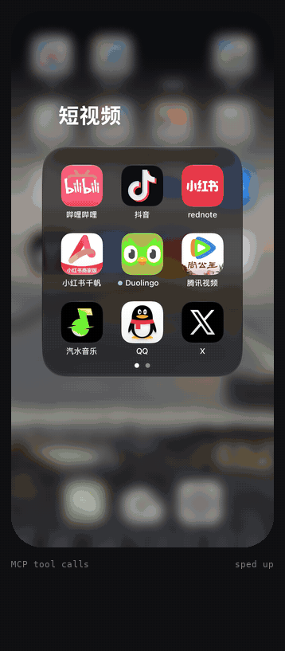
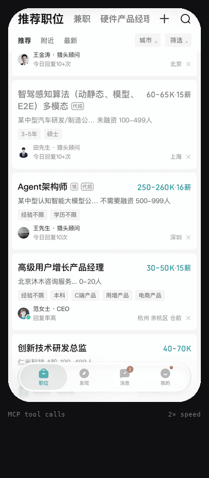

<p align="center"><a href="https://github.com/jiefeng-ai/phonectl-mcp/blob/main/README.md">English</a> · 中文</p>

<h1 align="center"><picture><source media="(prefers-color-scheme: dark)" srcset="https://raw.githubusercontent.com/jiefeng-ai/phonectl-mcp/main/docs/logo-dark.svg?v=4"></picture> phonectl-mcp</h1>

<p align="center"><b>让 AI agent 从 Mac 上看见并操作一台真实的 iPhone，插线或走 Wi-Fi 都行。</b></p>

<p align="center">
  <a href="https://pypi.org/project/phonectl-mcp/"></a>
  
  
  <a href="https://modelcontextprotocol.io"></a>
  <a href="https://github.com/jiefeng-ai/phonectl-mcp/actions/workflows/test.yml"></a>
  <a href="https://github.com/jiefeng-ai/phonectl-mcp/blob/main/LICENSE"></a>
</p>

<p align="center"><a href="#安装">安装</a> · <a href="#工具">工具</a> · <a href="#排查问题">排查问题</a> · <a href="#安全">安全</a></p>

一个 MCP 服务，对连着 Mac 的 iPhone 截图、读屏幕文字、点按、滑动、打字、按按钮、启动 App、读写剪贴板。手机上不用装东西，也不用越狱。

<table align="center">
  <tr>
    <td align="center" width="50%"></td>
    <td align="center" width="50%"></td>
  </tr>
  <tr>
    <td align="center"><sub>AI agent 在小红书做一篇图文：文字卡片、模板、贴纸、滤镜、正文，停在<b>发布</b>前。已加速。</sub></td>
    <td align="center"><sub>脚本在招聘 App 里投递一个岗位：<code>read_text</code> 找按钮，<code>tap</code> 点下去。2 倍速。</sub></td>
  </tr>
</table>

## 需要什么

- 一台装了 [uv](https://docs.astral.sh/uv/) 的 Mac
- 一台 **iOS 27 或以上**的 iPhone，打开「开发者模式」
- 一根能传数据的 USB 线（只能充电的不行），首次设置时要用；之后走 Wi-Fi 也行

已在 iPhone 17 Pro（iOS 27.2）+ macOS 27 上测试。

## 安装

### 让 agent 帮你装

把下面这段话发给你的编程 agent（Claude Code、Codex、Cursor 等）：

```text
安装 phonectl-mcp：https://github.com/jiefeng-ai/phonectl-mcp#install-by-hand
然后把它加进你的 MCP 配置，截一张我的手机屏幕确认能用。
需要我在手机上操作时，一步步告诉我，等我做完再继续。
```

### 手动安装

```sh
uv tool install phonectl-mcp
phonectl install-service   # 开机自启服务，地址 http://127.0.0.1:47321/mcp
phonectl doctor            # 检查数据线、信任、开发者模式、磁盘镜像和服务
```

`install-service` 还会在 `~/.config/phonectl/token` 生成访问令牌。然后接入客户端：

**Claude Code**

```sh
claude mcp add --scope user --transport http phone http://127.0.0.1:47321/mcp \
  --header "Authorization: Bearer $(cat ~/.config/phonectl/token)"
```

**Cursor**（`~/.cursor/mcp.json`）及其他支持 streamable HTTP 的客户端

```json
{
  "mcpServers": {
    "phone": {
      "url": "http://127.0.0.1:47321/mcp",
      "headers": { "Authorization": "Bearer <~/.config/phonectl/token 的内容>" }
    }
  }
}
```

装好后，让 agent 截一张手机屏幕试试。

用数据线设置过一次后，手机和 Mac 在同一个 Wi-Fi 下就可以不插线。

手机只接受一条控制连接，所以所有 agent 和脚本共用这一个服务；同一时间只让一个 agent 操作。

## 工具

坐标单位是 iOS 的 point，和返回的截图像素一一对应。

| 工具 | 作用 |
| --- | --- |
| `screenshot` | 截图 |
| `read_text` | 以 JSON 返回屏幕文字和位置，比看图省得多 |
| `tap`、`long_press`、`swipe` | 点按、长按、滑动。往下翻要向上滑 |
| `type_text` | 往当前输入框打字，非 ASCII 文字经剪贴板粘贴 |
| `press_key` | 按键或组合键，如 `enter`、`cmd+a` |
| `press_button` | `home`、`lock`、`volume-up`、`volume-down`、`mute`、`siri` |
| `launch_app`、`list_apps` | 启动 App，查 bundle id |
| `get_clipboard`、`set_clipboard` | 读写手机剪贴板 |
| `status` | 服务和手机连接状态 |

操作手机的工具会在操作后返回一张截图（传 `screenshot=False` 则不返回）。手机不确认点按是否生效，请看这张截图判断。

## 排查问题

先跑 `phonectl doctor`，它会告诉你断在哪一段。

| 现象 | 处理 |
| --- | --- |
| 找不到 iPhone | 换能传数据的线，解锁手机后重插 |
| 提示 Mac 未被信任 | 解锁手机，重插线，点「信任」 |
| 找不到「开发者模式」 | 手机连着 Mac 时打开一次 Xcode，之后「设置 › 隐私与安全性」里会出现开关 |
| 截图失败（比如手机重启后） | 插上线，运行 `phonectl doctor --fix` 装上开发者磁盘镜像 |
| 点了没反应 | 需要 iOS 27 及以上；保持屏幕亮着、不锁屏 |
| 客户端连不上 | `phonectl restart`，再看 `~/Library/Logs/phonectl.error.log`。返回 401 说明客户端的令牌和 `~/.config/phonectl/token` 不一致 |

## 安全

- 服务只监听 `127.0.0.1`，不带令牌的请求一律拒绝。
- agent 能做你手指能做的任何事：发消息、付款、删数据。请给它范围小的指令，并看着屏幕。使用风险自负，自动操作第三方 App 可能违反其用户协议。

## 配置

<details>
<summary>环境变量（设好后重新运行 <code>phonectl install-service</code>；<code>restart</code> 沿用旧值）</summary>

| 变量 | 默认值 | 含义 |
| --- | --- | --- |
| `PHONECTL_UDID` | 第一台连上的 iPhone | 连了多台手机时用哪一台 |
| `PHONECTL_PORT` | `47321` | HTTP 端口（只监听 127.0.0.1） |
| `PHONECTL_TOKEN_FILE` | `~/.config/phonectl/token` | 令牌文件位置 |
| `PHONECTL_SCALE` | `3` | 每 point 几个像素；iPhone SE、XR、11 填 2。只影响截图大小 |
| `PHONECTL_OCR_LANGS` | `zh-Hans,en-US` | `read_text` 识别语言，按优先级 |
| `PHONECTL_SETTLE` | `0.6` | 操作后等几秒再截图 |
| `PHONECTL_TOUCH_IDLE` | `30` | 空闲几秒后关闭输入通道（重开约 0.6 秒） |
| `PHONECTL_CALL_TIMEOUT` | `15` | 等手机响应几秒算失败（不含手势耗时） |
| `PHONECTL_LOG` | `WARNING` | 日志级别（服务为 `INFO`），日志在 `~/Library/Logs/phonectl*.log` |

</details>

其他命令：`phonectl restart`（比如 `uv tool upgrade phonectl-mcp` 升级之后）。卸载：`phonectl uninstall-service`、`uv tool uninstall phonectl-mcp`，再删掉 `~/.config/phonectl`。

## 开发

```sh
git clone https://github.com/jiefeng-ai/phonectl-mcp
cd phonectl-mcp
uv sync
uv run pytest
```

在仓库目录里执行 `uv run phonectl install-service`，服务就会跑你本地的代码。

## 协议

MIT
